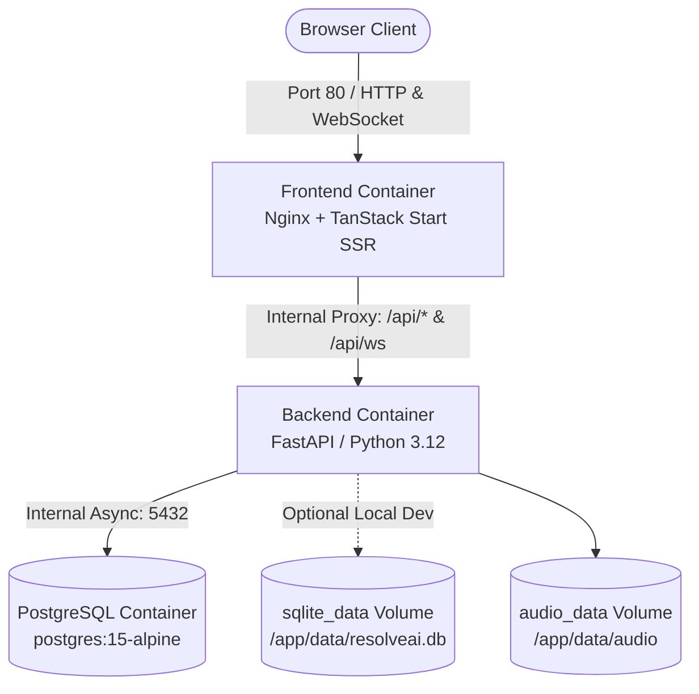

# ResolveAI V2 — Production Dockerization & Operations Guide

This guide documents the container architecture, orchestration workflows, security posture, and troubleshooting steps for deploying **ResolveAI V2** using Docker and Docker Compose.

---

## 1. Container Architecture

ResolveAI V2 runs as a multi-container architecture connected via an isolated internal bridge network (`resolveai_net`):



### Components

| Service | Base Image | Internal Port | External Port | User | Health Check |
|---|---|---|---|---|---|
| **`postgres`** | `postgres:15-alpine` | `5432` | None (internal) | `postgres` (70) | `pg_isready` |
| **`backend`** | `python:3.12-slim` | `8000` | `8000:8000` (optional direct access) | `appuser` (1000) | `curl -f http://localhost:8000/health/live` |
| **`frontend`** | `node:20-alpine` | `8080` (Nginx), `3000` (Node SSR) | `80:8080` | `node` (1000) | `curl -f http://127.0.0.1:8080/healthz` |

---

## 2. Security & Rootless Design

Both application containers adhere strictly to container security standards:
- **Non-Root Execution:** 
  - Backend runs as unprivileged user `appuser` (`UID 1000`).
  - Frontend runs as unprivileged user `node` (`UID 1000`).
- **Nginx Rootless Reverse Proxy:**
  - Nginx runs in user space on port `8080`, with temporary directories redirected to `/tmp/`.
  - Host port `80` binds cleanly to container port `8080` via Docker port mapping.
- **Zero Secrets in Images:**
  - All credentials, API keys, and environment variables are injected at runtime via `.env` or Compose environment declarations.
  - `.dockerignore` blocks `.env`, `.env.*`, `*.db`, `backend/data/audio/`, and private reports from Docker contexts.
- **Automated Safe Migrations:**
  - Alembic migrations execute automatically on startup via `start.sh` before the application begins accepting traffic.

---

## 3. Quick Start (PostgreSQL Production Mode)

This is the recommended configuration for production and multi-user environments.

### Step 1: Prepare Environment

Copy the environment template:
```bash
cp .env.example .env
```
*(On Windows PowerShell: `Copy-Item .env.example .env`)*

Configure your AI provider keys (Groq, Gemini, or OpenAI) and secure secret keys:
```ini
JWT_SECRET_KEY=generate_a_secure_random_key
AI_PROVIDER=groq
GROQ_API_KEY=your_key_here
```

### Step 2: Build and Start Stack

```bash
docker compose up --build -d
```

### Step 3: Verify Status & Health

```bash
docker compose ps
```

All three services (`resolveaiv2-postgres`, `resolveaiv2-backend`, `resolveaiv2-frontend`) will report `healthy`.

### Step 4: Access the Application

- **Web Application:** [http://localhost](http://localhost)
- **FastAPI OpenAPI Swagger:** [http://localhost:8000/docs](http://localhost:8000/docs)
- **Backend Health Liveness:** [http://localhost:8000/health/live](http://localhost:8000/health/live)
- **Backend Health Readiness:** [http://localhost:8000/health/ready](http://localhost:8000/health/ready)

---

## 4. Quick Start (SQLite Lightweight Mode)

For quick local evaluation or continuous integration without spinning up a PostgreSQL database:

```bash
docker compose -f docker-compose.sqlite.yml up --build -d
```

This starts only the backend and frontend containers, mounting a dedicated `sqlite_data` Docker volume at `/app/data` where `resolveai.db` resides.

---

## 5. Useful Commands

### Viewing Logs

```bash
# Follow logs for all services
docker compose logs -f

# Follow backend logs only
docker compose logs -f backend

# Follow frontend logs only
docker compose logs -f frontend
```

### Executing Commands in Running Containers

```bash
# Apply database migrations manually
docker compose exec backend alembic upgrade head

# Seed knowledge base
docker compose exec backend python -m scripts.seed_knowledge

# Run backend pytest suite inside the container
docker compose exec backend pytest -q
```

### Stopping the Stack

```bash
# Stop containers without removing persistent data volumes
docker compose down

# Stop and remove volumes (CAUTION: Deletes PostgreSQL and SQLite data!)
docker compose down -v
```

### Cleaning Docker Build Cache Safely

To reclaim disk space without destroying database volumes:
```bash
docker builder prune -f
```

> [!CAUTION]
> Never run `docker volume prune -a` unless you intend to erase all persistent database data and stored audio files.

---

## 6. Running Locally Without Docker (Windows 11 / macOS / Linux)

Docker is completely optional for local development. ResolveAI V2 can run directly on the host:

### Backend:
```powershell
cd backend
python -m venv .venv
.\.venv\Scripts\Activate.ps1
pip install -r requirements.txt
alembic upgrade head
uvicorn app.main:app --reload --port 8000
```

### Frontend:
```powershell
cd frontend
npm ci
npm run dev
```

The Vite development server runs on `http://localhost:5173` and automatically proxies `/api` and WebSockets to `http://localhost:8000`.

